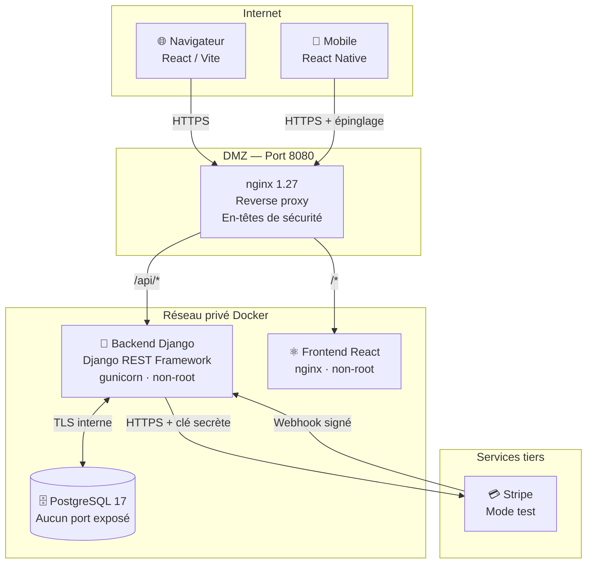

<div align="center">

<h1>🔐 SecOnDemand</h1>

<p><strong>Plateforme de services de cybersécurité à la demande</strong><br/>
Test d'intrusion · Surveillance SOC · Audit cloud · Analyse de vulnérabilités</p>

[](https://github.com/SALMA-ESSAOUD/ai-devsecops-python-securite-on-demand/actions/workflows/ci.yml)
[](https://www.python.org/)
[](https://www.djangoproject.com/)
[](https://react.dev/)
[](https://www.typescriptlang.org/)
[](https://docs.docker.com/compose/)
[](https://www.postgresql.org/)
[](LICENSE)

<p>
  <a href="#-aperçu">Aperçu</a> ·
  <a href="#-architecture">Architecture</a> ·
  <a href="#-démarrage-rapide">Démarrage rapide</a> ·
  <a href="#-pipeline-ci">Pipeline CI</a> ·
  <a href="#-sécurité">Sécurité</a> ·
  <a href="#-contribuer">Contribuer</a>
</p>

<sub>Projet 5 — Module « Sécurité des applications et des services » · Cycle ingénieur SIT 3 · UCA FST Marrakech · 2026/2027</sub><br/>
<sub>Équipe : Hind Zabrati · Imane Arrach · Salma Essaoud · Salma Bender</sub>

</div>

---

## 📌 Aperçu

**SecOnDemand** est une plateforme web et mobile qui commercialise des **services de cybersécurité à la demande** : test d'intrusion, surveillance SOC, audit de configuration cloud et analyse de vulnérabilités.

Le projet a deux objectifs indissociables :

| Objectif | Description |
|---|---|
| **Application** | Développer une plateforme fonctionnelle avec panier, commande et paiement simulé via Stripe (mode test) |
| **Pipeline DevSecOps** | Concevoir et démontrer une pipeline CI/CD augmentée par l'IA qui met en œuvre les 11 pratiques Tier 1 (Prates & Pereira, 2025) et couvre les référentiels OWASP Top 10 : 2025, API Security Top 10, Mobile Top 10 et Top 10 for LLM Applications |

> ⚠️ Aucune donnée bancaire réelle n'est traitée. Tous les paiements sont simulés avec les cartes de test Stripe.

---

## 🏗️ Architecture



### Modules métier

| Module | Responsabilités |
|---|---|
| **Comptes et accès** | Inscription, authentification JWT, rôles client / administrateur, MFA TOTP |
| **Missions et rapports** | Catalogue des prestations, suivi de l'état, téléchargement sécurisé par lien signé |
| **Paiements** | Montant calculé côté serveur, création PaymentIntent, validation webhook, émission de reçus |

---

## 🗂️ Structure du dépôt

```
ai-devsecops-python-securite-on-demand/
│
├── backend/                        # API REST (Django + DRF)
│   ├── apps/
│   │   └── health/                 # GET /api/health/ → {"status":"ok"}
│   ├── config/
│   │   └── settings/
│   │       ├── base.py             # Paramètres communs (DEBUG=False par défaut)
│   │       ├── dev.py              # Développement local
│   │       └── prod.py             # Production (SECRET_KEY obligatoire)
│   ├── tests/                      # pytest — sans dépendance à la DB pour /health/
│   ├── Dockerfile                  # python:3.14-slim · utilisateur non root (UID 1001)
│   ├── requirements.txt            # Versions figées et vérifiées
│   └── ruff.toml                   # Linter Python
│
├── web/                            # Front-end (React 19 · Vite 8 · TypeScript 7)
│   ├── src/
│   │   ├── App.tsx                 # Appel /api/health/ · affichage du statut
│   │   └── main.tsx
│   ├── Dockerfile                  # Build multi-étapes · nginx:1.27-alpine non root
│   ├── nginx.conf                  # Port 8080 · SPA routing
│   └── vite.config.ts              # Proxy /api/ → localhost:8000 en dev
│
├── mobile/                         # Application React Native (à venir)
│
├── infra/
│   └── nginx/
│       └── nginx.conf              # Reverse proxy · X-Frame-Options · nosniff · Referrer-Policy
│
├── docs/
│   └── threat-model/               # Modèle de menaces STRIDE v1.0 (50 menaces · T01–T50)
│
├── .github/
│   ├── workflows/
│   │   └── ci.yml                  # Lint · Tests · Build Docker (SHA 40 car. épinglés)
│   ├── CODEOWNERS                  # Revue obligatoire : @SALMA-ESSAOUD
│   └── pull_request_template.md    # Checklist sécurité liée au modèle de menaces
│
├── docker-compose.yml              # Services : db · backend · web · nginx
├── .env.example                    # Template des variables d'environnement
└── .gitignore
```

---

## 🚀 Démarrage rapide

### Prérequis

- [Docker](https://docs.docker.com/get-docker/) ≥ 24 et Docker Compose v2
- [Git](https://git-scm.com/)

### 1 — Cloner le dépôt

```bash
git clone git@github.com:SALMA-ESSAOUD/ai-devsecops-python-securite-on-demand.git
cd ai-devsecops-python-securite-on-demand
```

### 2 — Configurer l'environnement

```bash
cp .env.example .env
# Ouvrir .env et remplacer toutes les valeurs "changeme-"
```

### 3 — Démarrer tous les services

```bash
docker compose up --build
```

| Service | URL |
|---|---|
| Application complète | http://localhost:8080 |
| Endpoint de santé API | http://localhost:8080/api/health/ |

### Développement backend (hors Docker)

```bash
cd backend
python -m venv .venv && source .venv/bin/activate
pip install -r requirements.txt
export DJANGO_SETTINGS_MODULE=config.settings.dev
pytest                   # Tests sans base de données requise
```

### Développement front-end (hors Docker)

```bash
cd web
npm install
npm run dev              # Vite démarre sur http://localhost:5173
                         # Le proxy /api/ redirige vers http://localhost:8000
```

---

## ⚙️ Pipeline CI

Le workflow [`.github/workflows/ci.yml`](.github/workflows/ci.yml) se déclenche automatiquement sur chaque `push` vers `main` et sur chaque `pull_request`.

```
push / pull_request
        │
        ├─── lint ──────────── ruff 0.17.5
        │                      Vérifie le style et les erreurs statiques Python
        │
        ├─── tests ─────────── pytest 9.2 + service PostgreSQL 17
        │                      Route /api/health/ · non-régression
        │
        └─── docker-build ──── Conditionné à lint + tests
             (needs: lint, tests)
                                Build backend (python:3.14-slim)
                                Build web    (node:22-alpine → nginx:1.27-alpine)
                                push: false  ← jamais de push en CI
```

**Règles de sécurité du workflow :**

| Règle | Valeur |
|---|---|
| Trigger interdit | `pull_request_target` — jamais utilisé |
| Permissions workflow | `contents: read` uniquement |
| Épinglage des actions | SHA 40 caractères (commit exact, non le tag) |

<details>
<summary>SHA des actions utilisées</summary>

| Action | Version | SHA |
|---|---|---|
| `actions/checkout` | v4 | `11d5960a326750d5838078e36cf38b85af677262` |
| `actions/setup-python` | v5 | `a26af69be951a213d495a4c3e4e4022e16d87065` |
| `docker/setup-buildx-action` | v3 | `8d2750c68a42422c14e847fe6c8ac0403b4cbd6f` |
| `docker/build-push-action` | v6 | `10e90e3645eae34f1e60eeb005ba3a3d33f178e8` |

</details>

---

## 🔒 Sécurité

### Modèle de menaces

Le modèle de menaces (méthode STRIDE, v1.0) est versionné dans [`docs/threat-model/`](docs/threat-model/).

| Niveau | Critique | Élevé | Modéré | Faible | Total |
|---|:---:|:---:|:---:|:---:|:---:|
| Menaces | 3 | 17 | 28 | 2 | **50** |

Les trois menaces critiques disposent chacune d'un **test automatisé bloquant** en CI :

| ID | Menace | Contre-mesure principale |
|---|---|---|
| T01 | Bourrage d'identifiants | Argon2 · 5 tentatives / 15 min · MFA |
| T07 | Accès aux objets d'un autre client (BOLA) | Querysets filtrés par propriétaire · UUID |
| T17 | Modification du montant du paiement | Montant calculé côté serveur uniquement |

### Décisions de sécurité de l'infrastructure

| Décision | Menace couverte |
|---|---|
| `DEBUG=False` par défaut dans `base.py` | T15 — fuite d'informations techniques |
| `SECRET_KEY` depuis l'env, erreur explicite si absente en prod | T05 — falsification JWT |
| Conteneurs non root (UID 1001 / UID 101) | T34 — évasion de conteneur |
| PostgreSQL sans port exposé à l'hôte | T32 — accès réseau direct à la DB |
| Réseau Docker isolé `backend_net` | T32 — isolation DB / nginx |
| En-têtes HTTP : `X-Content-Type-Options`, `X-Frame-Options`, `Referrer-Policy` | T36 — mauvaise configuration |
| Actions CI épinglées par SHA 40 caractères | T42 — compromission de workflow |
| `CODEOWNERS` + template de PR | T43 — fusion de code non revu |

---

## 🤝 Contribuer

1. Créer une branche depuis `main`
2. Ouvrir une **pull request** — le template s'affiche automatiquement
3. Remplir la **checklist de sécurité** et indiquer la menace concernée (T01–T50)
4. Le CI doit passer intégralement (lint + tests + build)
5. La revue de `@SALMA-ESSAOUD` est requise (CODEOWNERS)

---

## 📄 Licence

Projet universitaire — usage académique uniquement.
Université Cadi Ayyad (UCA) · FST Marrakech · 2026/2027
